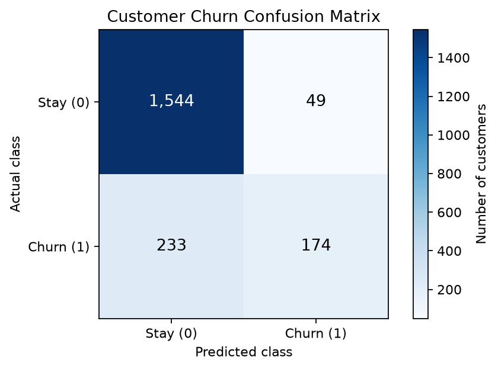
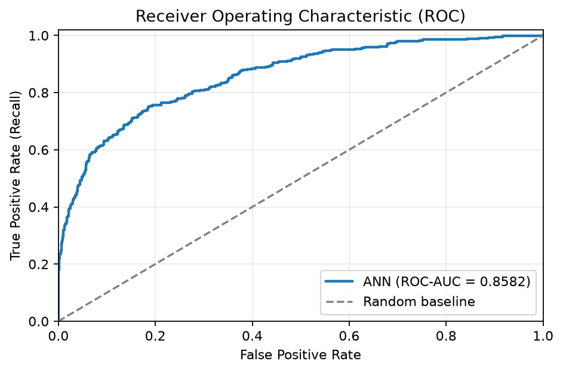
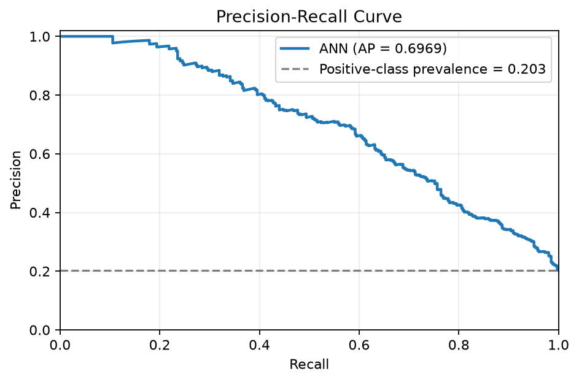
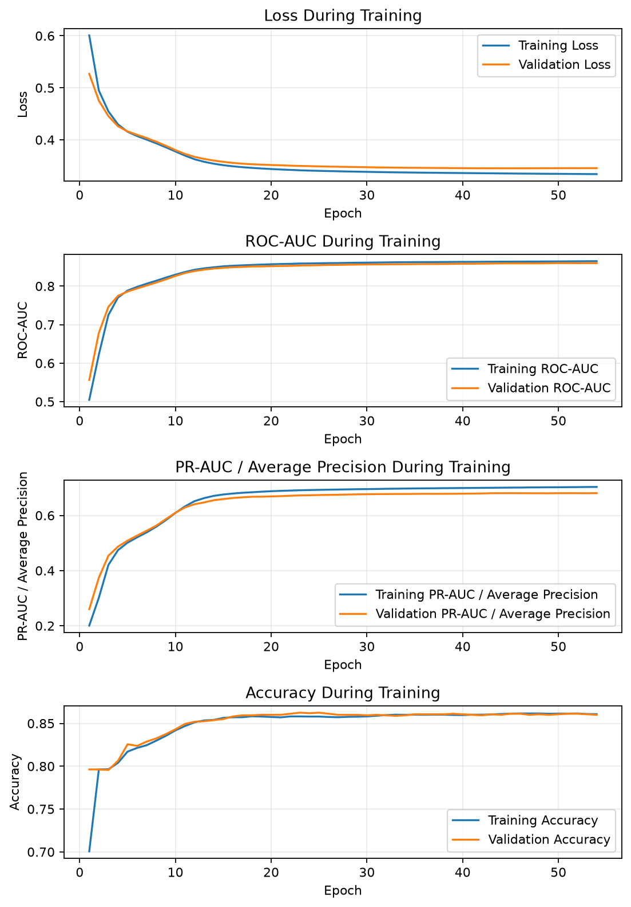

# Customer Churn ANN — Statistical Evaluation Report

**Generated:** 2026-10-29T13:10:44.212719-04:00

## 1. Executive summary

The model was evaluated on **2,000 held-out test observations**. Accuracy was **85.90%**, ROC-AUC was **0.8582**, precision was **78.03%**, and recall was **42.75%** at a classification threshold of **0.50**.

The ROC-AUC indicates strong ranking discrimination on this test set. Recall is relatively low at the selected threshold. Review threshold tuning on validation data if identifying more churners is a business priority.

These results describe performance on this test set; they do not by themselves establish statistical significance or business impact.

## 2. Evaluation metrics

| Metric | Result |
|---|---:|
| Accuracy | 0.8590 (85.90%) |
| Precision | 0.7803 (78.03%) |
| Recall / Sensitivity | 0.4275 (42.75%) |
| F1 score | 0.5524 |
| ROC-AUC | 0.8582 |
| Average precision (PR-AUC field) | 0.6969 |
| Specificity | 0.9692 (96.92%) |
| Classification threshold | 0.50 |

Average precision is calculated with scikit-learn's `average_precision_score`; it is not the trapezoidal integral of the precision-recall curve.

## 3. Confusion matrix

| Actual class | Predicted stay (0) | Predicted churn (1) | Total |
|---|---:|---:|---:|
| Stay (0) | 1,544 | 49 | 1,593 |
| Churn (1) | 233 | 174 | 407 |
| **Total** | **1,777** | **223** | **2,000** |

- False-positive rate: **3.08%**.
- False-negative rate: **57.25%**.
- Churn prevalence in test set: **20.35%**.

At this threshold, the model identified 174 of 407 actual churners and missed 233. It flagged 223 customers as potential churners.

## 4. Diagnostic charts

### ROC curve

### Precision-recall curve

### Training and validation curves

Review the curves for divergence between training and validation performance. Early stopping alone does not prove that overfitting has been eliminated.

## 5. Interpretation and limitations

- Precision and recall reflect the selected classification threshold.
- ROC-AUC measures ranking discrimination, not probability calibration.
- Average precision should be interpreted relative to churn prevalence and suitable baseline models.
- The results do not establish causality or the effectiveness of retention interventions.
- Confirm that preprocessing was fitted only on training data and that the test set was not used for model or threshold selection.

## 6. Recommendations

1. Tune the classification threshold using validation data; do not select it using the final test set.
2. Compare against logistic regression and tree-based baselines using identical data splits.
3. Estimate intervention costs and retention benefits before selecting an operating threshold.
4. Assess probability calibration and evaluate performance on later customer cohorts.

## 7. Reproducibility

- Test observations: 2,000
- Positive-class prevalence: 0.2035
- Decision threshold: 0.50
- Detailed metrics: `metrics.json`
- Model and preprocessing artifacts should be versioned separately.

---

This report was generated automatically from the current run's test labels, predicted probabilities, evaluation metrics, and training history.
